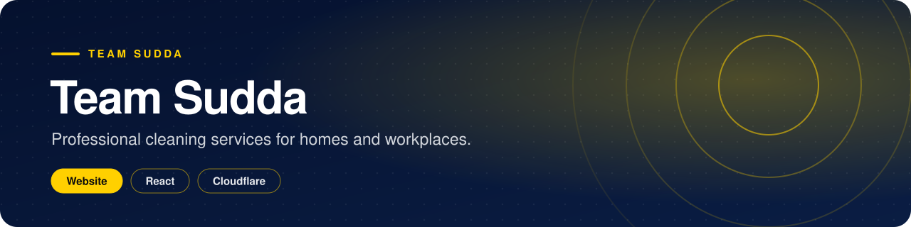
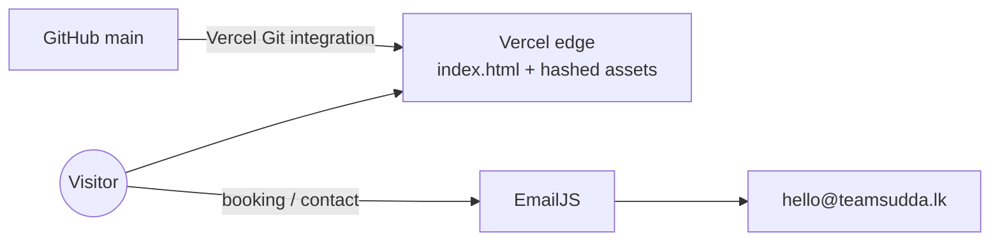
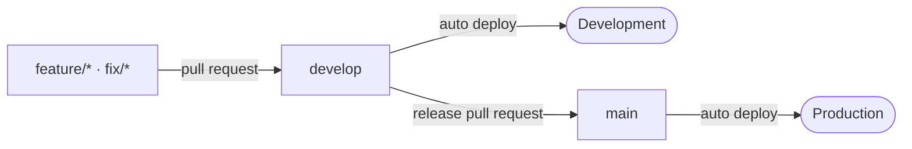

<a id="readme-top"></a>

<div align="center">



<br/>

<p><strong>The official website of Team Sudda: home, office and deep-cleaning services across Colombo, Sri Lanka.</strong></p>

<a href="https://github.com/saadmaz/Team-Sudda/releases"></a>
<a href="https://github.com/saadmaz/Team-Sudda/actions/workflows/ci.yml"></a>
<a href="https://github.com/saadmaz/Team-Sudda/deployments"></a>
<a href="https://github.com/saadmaz/Team-Sudda/commits/develop"></a>


<br/>

<a href="https://teamsudda.lk"></a>
<a href="docs/README.md"></a>
<a href="https://github.com/saadmaz/Team-Sudda/issues/new?template=bug_report.yml"></a>
<a href="https://github.com/saadmaz/Team-Sudda/issues/new?template=feature_request.yml"></a>

<br/>

<a href="#about">About</a> ·
<a href="#features">Features</a> ·
<a href="#architecture">Architecture</a> ·
<a href="#getting-started">Getting started</a> ·
<a href="#deployment">Deployment</a> ·
<a href="#documentation">Documentation</a> ·
<a href="#contributing">Contributing</a>

</div>

---

<details>
<summary><strong>Table of contents</strong></summary>

1. [About](#about)
2. [Features](#features)
3. [Architecture](#architecture)
4. [Tech stack](#tech-stack)
5. [Getting started](#getting-started)
6. [Configuration](#configuration)
7. [Project structure](#project-structure)
8. [Quality checks](#quality-checks)
9. [Deployment](#deployment)
10. [Documentation](#documentation)
11. [Releases and versioning](#releases-and-versioning)
12. [Contributing](#contributing)
13. [Security](#security)
14. [License](#license)

</details>

## About

Team Sudda is a professional cleaning team serving homes and businesses across Colombo. This repository powers [teamsudda.lk](https://teamsudda.lk): the services, pricing and booking flow customers use to arrange a clean.

| At a glance      |                                                                   |
| ---------------- | ----------------------------------------------------------------- |
| **Organisation** | Tank Sudda (Pvt) Ltd                                              |
| **Status**       | Live                                                              |
| **Website**      | [teamsudda.lk](https://teamsudda.lk)                              |
| **Contact**      | [hello@teamsudda.lk](mailto:hello@teamsudda.lk) · +94 74 100 4296 |
| **Maintainer**   | [Saad Mazhar](https://github.com/saadmaz)                         |

<p align="right"><a href="#readme-top">Back to top ↑</a></p>

## Features

<table>
<tr><td width="50%" valign="top"><strong>Service catalogue</strong><br/>Home, office, deep, post-renovation, sofa and carpet, sanitisation, after-event and move-in/move-out cleaning.</td><td width="50%" valign="top"><strong>Transparent pricing</strong><br/>Basic, Standard and Business plans.</td></tr>
<tr><td width="50%" valign="top"><strong>Online booking</strong><br/>A validated booking form at <code>/book</code>, delivered by email through EmailJS.</td><td width="50%" valign="top"><strong>Trust signals</strong><br/>Team profiles, client logos, testimonials, gallery and FAQ.</td></tr>
<tr><td width="50%" valign="top"><strong>Blog</strong><br/>Cleaning guides with individual article pages.</td><td width="50%" valign="top"><strong>SEO</strong><br/>Per-page titles, descriptions, canonical URLs, Open Graph tags and JSON-LD structured data.</td></tr>
<tr><td width="50%" valign="top"><strong>Always-on contact</strong><br/>Floating WhatsApp button and click-to-call on every page.</td><td width="50%" valign="top"><strong>Legal pages</strong><br/>Privacy Policy and Terms.</td></tr>
</table>

<p align="right"><a href="#readme-top">Back to top ↑</a></p>

## Architecture

A React single-page application built with Vite and hosted on Vercel. React Router renders each page client-side, `vercel.json` provides the SPA fallback and security headers, and the booking and contact forms send email through EmailJS.



> [!TIP]
> The full design, with every component and data flow, is in [docs/ARCHITECTURE.md](docs/ARCHITECTURE.md). Significant decisions are recorded as [architecture decision records](docs/adr/README.md).

<p align="right"><a href="#readme-top">Back to top ↑</a></p>

## Tech stack

<p>


</p>

<details>
<summary><strong>Full stack breakdown</strong></summary>

| Layer     | Technology                                       |
| --------- | ------------------------------------------------ |
| Framework | React 18 single-page app with React Router 6     |
| Language  | TypeScript                                       |
| Build     | Vite 5 with SWC                                  |
| Styling   | Tailwind CSS 3 and Radix-based UI primitives     |
| Motion    | Framer Motion                                    |
| Forms     | React Hook Form + Zod, delivered through EmailJS |
| Hosting   | Vercel                                           |
| Tooling   | npm, Vitest, Testing Library, ESLint             |

</details>

<p align="right"><a href="#readme-top">Back to top ↑</a></p>

## Getting started

### Prerequisites

- Node.js 20 or later (22 LTS recommended)
- Git

### Install and run

```sh
git clone https://github.com/saadmaz/Team-Sudda.git
cd Team-Sudda
npm ci
cp .env.example .env    # then fill in the EmailJS values
npm run dev
```

The site runs at **http://localhost:8080**.

<details>
<summary><strong>All scripts</strong></summary>

| Command              | Description                                  |
| -------------------- | -------------------------------------------- |
| `npm run dev`        | Start the development server with hot reload |
| `npm run build`      | Production build into `dist/`                |
| `npm run preview`    | Serve the production build locally           |
| `npm run lint`       | Lint with ESLint                             |
| `npm run typecheck`  | Type-check the project with `tsc`            |
| `npm test`           | Run the test suite once                      |
| `npm run test:watch` | Run tests in watch mode                      |

</details>

<p align="right"><a href="#readme-top">Back to top ↑</a></p>

## Configuration

Three public, domain-restricted EmailJS values (`VITE_EMAILJS_*`) enable form delivery. All copy and business data lives in `src/lib/constants/`.

<details>
<summary><strong>Environment variables</strong></summary>

| Variable                   | Purpose                                                                                                 |
| -------------------------- | ------------------------------------------------------------------------------------------------------- |
| `VITE_EMAILJS_SERVICE_ID`  | EmailJS service that delivers the message                                                               |
| `VITE_EMAILJS_TEMPLATE_ID` | Template using `{{from_name}}`, `{{from_email}}`, `{{phone}}`, `{{service}}`, `{{date}}`, `{{message}}` |
| `VITE_EMAILJS_PUBLIC_KEY`  | EmailJS public key                                                                                      |

Where each value is set, and which are secret: [docs/CONFIGURATION.md](docs/CONFIGURATION.md).

</details>

> [!NOTE]
> Copy, business data, imagery and articles are edited as described in [docs/CONTENT.md](docs/CONTENT.md).

<p align="right"><a href="#readme-top">Back to top ↑</a></p>

## Project structure

<details>
<summary><strong>Repository layout</strong></summary>

```
.
├── .github/                 # CI workflow, issue and pull request templates
├── public/                  # Static files: robots.txt, favicon, social image
├── src/
│   ├── assets/              # Photography
│   ├── components/          # Page sections: Hero, Services, Pricing, Contact...
│   │   └── ui/              # Radix-based UI primitives
│   ├── hooks/               # useSEO and UI hooks
│   ├── lib/
│   │   ├── constants/       # All site content: services, pricing, team, blog, FAQ, contact
│   │   └── emailjs.ts       # Email delivery for forms
│   ├── pages/               # One component per route
│   └── test/                # Vitest setup and tests
├── vercel.json              # SPA routing, security headers and caching
└── vite.config.ts           # Build configuration
```

</details>

<p align="right"><a href="#readme-top">Back to top ↑</a></p>

## Quality checks

Every pull request into `develop` or `main` runs the [CI workflow](.github/workflows/ci.yml): lint, formatting, type check, tests and a production build. Pull requests merge only when CI is green.

```sh
npm run lint && npm run format:check && npm run typecheck && npm test && npm run build
```

> [!IMPORTANT]
> Run the same checks locally before opening a pull request. They are the exact commands CI runs.

<p align="right"><a href="#readme-top">Back to top ↑</a></p>

## Deployment

| Environment | Branch    | URL                                          | Status                                                                                                                                                         |
| ----------- | --------- | -------------------------------------------- | -------------------------------------------------------------------------------------------------------------------------------------------------------------- |
| Development | `develop` | [dev.teamsudda.lk](https://dev.teamsudda.lk) |  |
| Production  | `main`    | [teamsudda.lk](https://teamsudda.lk)         |       |



Vercel builds and serves each branch; the Deploy workflow verifies the build and the live URL. Environments, setup, secrets and post-deployment checks are in [docs/DEPLOYMENT.md](docs/DEPLOYMENT.md).

> [!TIP]
> To ship or undo a release, follow the [release](docs/runbooks/release.md) and [rollback](docs/runbooks/rollback.md) runbooks.

<p align="right"><a href="#readme-top">Back to top ↑</a></p>

## Documentation

Every STTPS repository uses the same documentation layout.

| Document                               | Covers                                               |
| -------------------------------------- | ---------------------------------------------------- |
| [Documentation index](docs/README.md)  | Every document in this repository                    |
| [Architecture](docs/ARCHITECTURE.md)   | How the system is built and how data flows           |
| [Configuration](docs/CONFIGURATION.md) | Environment variables and configuration files        |
| [Deployment](docs/DEPLOYMENT.md)       | Environments, hosting, pipeline and first-time setup |
| [Content](docs/CONTENT.md)             | Updating copy, business data, imagery and articles   |
| [Decision records](docs/adr/README.md) | Why the system is built the way it is                |
| [Runbooks](docs/runbooks/README.md)    | Release and rollback procedures                      |

<p align="right"><a href="#readme-top">Back to top ↑</a></p>

## Releases and versioning

[](https://github.com/saadmaz/Team-Sudda/releases)

The project follows [Semantic Versioning](https://semver.org). Every release is tagged `vX.Y.Z`, published on the [Releases](https://github.com/saadmaz/Team-Sudda/releases) page with its notes, and recorded in [CHANGELOG.md](CHANGELOG.md). The procedure is in [docs/runbooks/release.md](docs/runbooks/release.md).

<p align="right"><a href="#readme-top">Back to top ↑</a></p>

## Contributing

| Step |                                                                           |
| ---- | ------------------------------------------------------------------------- |
| 1    | Branch from `develop` using a type prefix (`feat/`, `fix/`, `docs/`, ...) |
| 2    | Commit with [Conventional Commits](https://www.conventionalcommits.org)   |
| 3    | Open a pull request into `develop` and complete the checklist             |
| 4    | Squash and merge once CI is green and the change is reviewed              |

The full guide is in [CONTRIBUTING.md](CONTRIBUTING.md). Everyone taking part follows the [Code of Conduct](CODE_OF_CONDUCT.md).

<p align="right"><a href="#readme-top">Back to top ↑</a></p>

## Security

> [!IMPORTANT]
> Never report a vulnerability in a public issue. Follow [SECURITY.md](SECURITY.md) to report it privately; you will hear back within three business days.

<p align="right"><a href="#readme-top">Back to top ↑</a></p>

## License

Copyright © 2026 Tank Sudda (Pvt) Ltd. All rights reserved.

This is proprietary software. The source is publicly visible, but no permission is granted to use, copy, modify or distribute it without prior written consent. See [LICENSE](LICENSE.md).

<div align="center">
<br/>
<sub>Built and maintained by the Tank Sudda team · Part of the <a href="https://sttps.co">STTPS group</a></sub>
</div>
