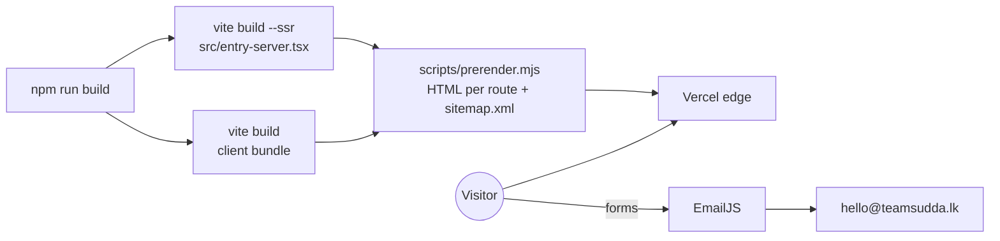

# Architecture

<!-- nav -->

<a href="../README.md">Project README</a> · <a href="README.md">Documentation index</a>

> How teamsudda.lk is built and served. Part of the [project documentation](README.md).

## Overview

teamsudda.lk is a React application built with Vite and hosted on Vercel. At build time every public route is pre-rendered to static HTML with its own metadata, so visitors and search engines get the full page immediately; React then hydrates it in the browser. Forms send email through EmailJS; the site has no backend of its own.

## Building blocks

| Part                        | Responsibility                                                                      |
| --------------------------- | ----------------------------------------------------------------------------------- |
| `src/App.tsx`               | Route table (`AppRoutes`); every page except the homepage is lazy-loaded            |
| `src/components/layout/`    | Shared layout: navigation, footer, mobile contact bar, scroll handling, page views  |
| `src/components/blocks.tsx` | Reusable page sections: hero, headings, checklist, cards, call-to-action band       |
| `src/components/forms/`     | Schema-driven enquiry form used by all five forms                                   |
| `src/pages/`                | Page templates; services, industries and areas each use one template for all pages  |
| `src/lib/content/`          | Structured content: services, industries, areas, standard, forms, navigation        |
| `src/lib/constants/`        | Contact details, FAQ, guides, pricing and other copy                                |
| `src/lib/forms.ts`          | Form validation, summary and delivery through EmailJS                               |
| `src/lib/analytics.ts`      | Google Analytics 4, loaded only when a measurement ID is configured                 |
| `src/lib/routes.ts`         | The list of public routes used for pre-rendering, the sitemap and tests             |
| `src/hooks/usePageMeta.ts`  | Per-page title, description, canonical URL and JSON-LD, in the browser and at build |
| `src/entry-server.tsx`      | Server render entry used by the pre-render script                                   |
| `scripts/prerender.mjs`     | Writes one HTML file per route and `sitemap.xml` into `dist/`                       |
| `vercel.json`               | Clean URLs, SPA fallback, security headers and asset caching                        |

Significant decisions are recorded in [adr/](adr/README.md).
