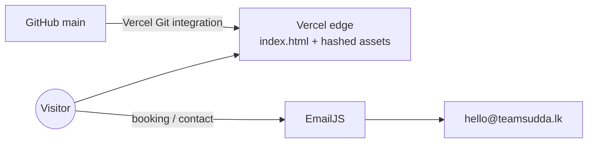

# Architecture

<!-- nav -->

<a href="../README.md">Project README</a> · <a href="README.md">Documentation index</a>

> How teamsudda.lk is built and served. Part of the [project documentation](README.md).

## Overview

teamsudda.lk is a React single-page application built with Vite and hosted on Vercel. The browser loads one HTML shell and React Router renders each page client-side. Booking and contact forms send email through EmailJS; the site has no backend of its own.

## Building blocks

| Part                  | Responsibility                                                     |
| --------------------- | ------------------------------------------------------------------ |
| `src/App.tsx`         | Route table (React Router); the catch-all 404 route stays last     |
| `src/pages/`          | One component per route                                            |
| `src/components/`     | Page sections such as Hero, Services, Pricing and Contact          |
| `src/lib/constants/`  | All copy and business data                                         |
| `src/lib/emailjs.ts`  | Form delivery                                                      |
| `src/hooks/useSEO.ts` | Per-page title, description, canonical URL, Open Graph and JSON-LD |
| `vercel.json`         | SPA fallback, security headers and asset caching                   |

Significant decisions are recorded in [adr/](adr/README.md).
